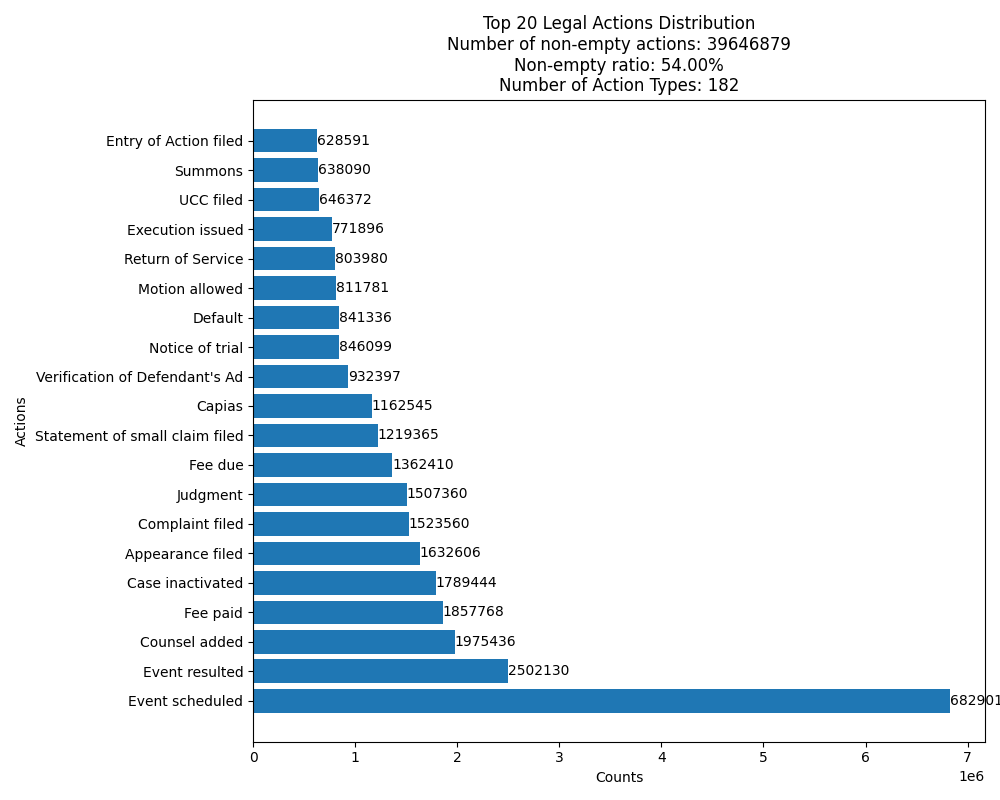

# EDA

## Count
Statistic the number of action and actor types
```
python count.py
```
```
SELECT action, COUNT(*) AS count FROM cdocs_case_action_index GROUP BY action"
SELECT actor, COUNT(*) AS count FROM cdocs_case_action_index GROUP BY actor"
```


## Label Distribution
```
python draw_data_distribution.py
```
Set the {TopN} at the top of the file  
'TopN = -1' means draw all types




## Sample Data

There are 73173625 rows of data.  
Useful columns: 
- case_action_id: primary key
- actor
- action
- description

We sample data based on the action type.  
We sample at most {LIMIT} rows per action type.

We will further experiment on "sampled_data_limit={LIMIT}.json"

### v1: in order 
```
python sample_data_v1_in_order.py
```

This method is relatively faster, but can only get the first at most LIMIT rows of every action_type.
```
query = f"""
           SELECT case_action_id, actor, action, description
           FROM {table_name}
           WHERE action = "{action_type}"
           LIMIT {_limit};
       """
```

### v2: random
```
python sample.py
```

The primary key is "case_action_id", we call it "id"
- Get ids of every action type and store them
    - Take relatively longer time than other following steps
    - Only need to run once
    - Easy to change {LIMIT} or resample later
- Sample ids from the id pools
- Fetch data with id
    - We can use "WHERE action IN (id1, id2, ...)" rather than "WHERE action = id", which is much faster. 

```
SELECT case_action_id FROM {table_name}
    WHERE action = "{action_type}"

SELECT case_action_id, actor, action, description FROM {table_name}
    WHERE case_action_id in (id1, id2, ...)
```


