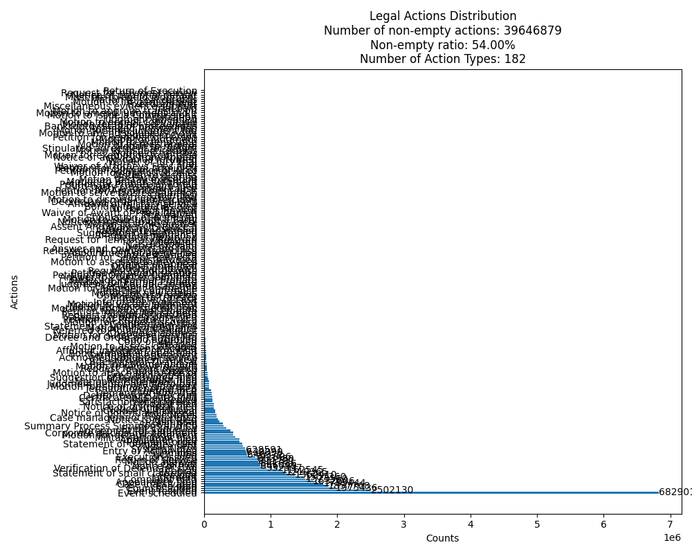
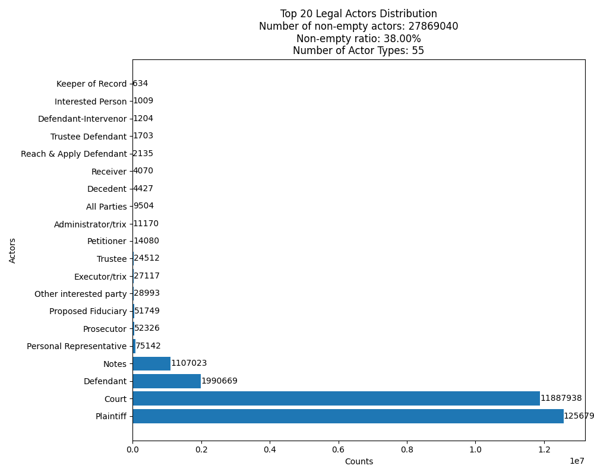
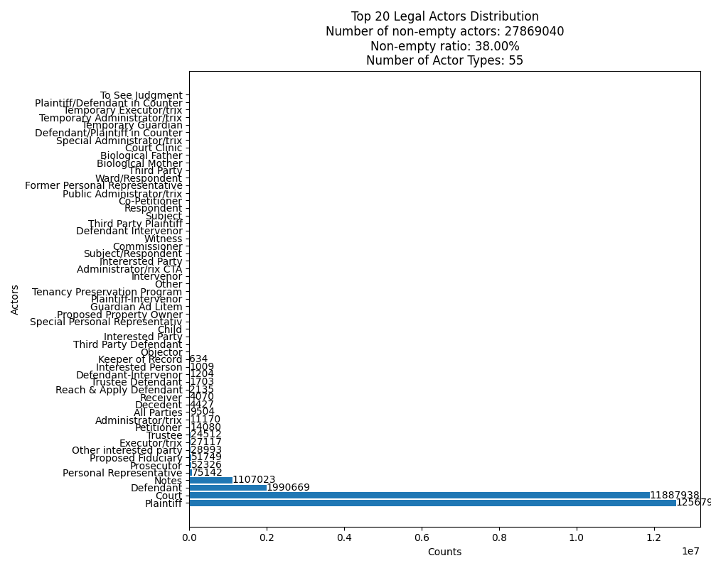

# EDA

## Count
Statistic the number of actions and actors types
```
python count.py
```
```
SELECT action, COUNT(*) AS count FROM cdocs_case_action_index GROUP BY action"
SELECT actor, COUNT(*) AS count FROM cdocs_case_action_index GROUP BY actor"
```


## Label Distribution
```
python draw_data_distribution.py
```
Set the {TopN} at the top of the file  
'TopN = -1' means draw all types






## Sample Data
```
python sample.py
```
At present, we sample data based on the action type. We sample at most {LIMIT} rows per action type.
```
query = f"""
           SELECT case_id, actor, action, description
           FROM {table_name}
           WHERE action = "{action_type}"
           LIMIT {_limit};
       """
```
We will further experiment on "sampled_data_based_on_actions_limit=10000.json"

